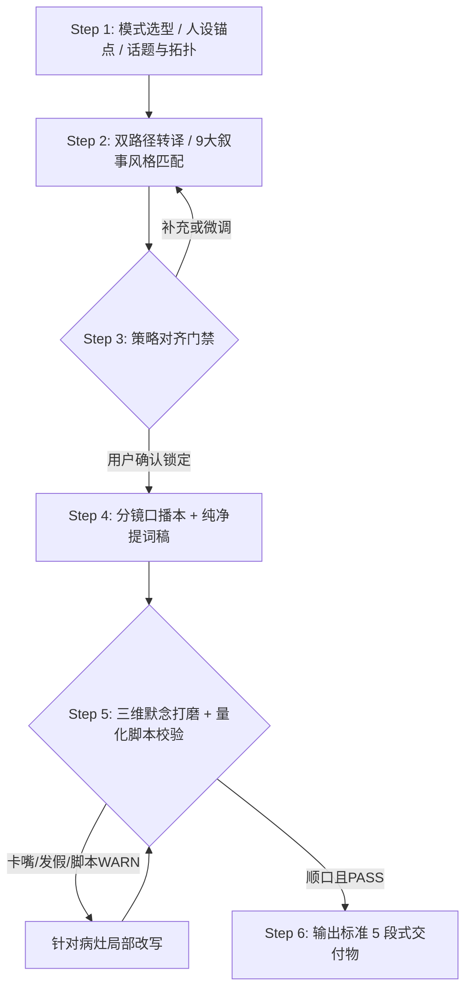

# 科普与深度口播剧本创作技能（Dual-Mode Spoken Script）

把枯燥科普或个人经验思考，转化为**人设鲜明、句长起伏、可进提词器直接开拍**的**符合人类听觉习惯、能吸引观众、有活人感**的高质量口播剧本，覆盖 **`hook`（强吸引短视频科普）** 与 **`companion`（反算法深度陪伴独白）** 双模式。

## 核心原则

1. **双模式节奏分流，身份与物理锚物先于台词**：先选定 **`hook`**（强吸引科普）或 **`companion`**（低姿态陪伴长聊），锁定“谁在说、用什么当期现场物件起合”，杜绝千篇一律播音腔或跨期套壳。
2. **科学降维与经验命名双路径**：`hook` 模式走“一核 × 一误区 × 一行动 + 兴趣黑话同构”；`companion` 模式先**暴露自身局限与盲区（认知谦卑）**，经细节蓄能后落出极简日常命名，不强塞干货清单。
3. **多线程网状对比（反流水账）**：主干推进一步，关键节点须带出对照视角与双面账（收益 + 代价），兼顾“祛魅而不犬儒”，前文点名人物 0 失踪、0 工具人。
4. **第一性原理去 AI 化**：遵循[反 AI 味与活人感第一性原理](references/anti-ai-dehumanization.md)的**六大高正交法则**与“三刀斩尾纪律”；`companion` 模式允许保留适度现场思考毛边与低密度蓄能对仗。
5. **先对齐，再打磨校验**：先锁定模式、策略与开场方向再起稿；出稿前对照“听觉习惯 × 观众吸引力 × 活人感”默念局部打磨，并由量化脚本核验通过。

## 标准创作工作流



### Step 1：模式选型、身份定位与可选拓扑核查
* 明确口播模式（`hook` 短/中视频强吸引科普 vs `companion` 中长视频坦诚陪伴独白）。
* 参照 [人设、受众与拓扑模型指南](references/persona-audience-mapping.md) 第 1–2 节，确立信任锚点（专业实战战绩 vs 敢先自剖局限的同行者）、五象限关系站位、**6 项语言指纹**（含**当期专属物理锚物**）与话题拆解框架。
* **多阶段长链路选题（可选）**：若用户给出主干序列（`Stage_1 → … → Stage_N`），先执行**三大线路现实核查算子**（时间序校核、制度/科学因果门槛核查、断点双解重构）并评估体量。

### Step 2：双路径内容转译与叙事风格匹配
* 使用 [人设、受众与拓扑模型指南](references/persona-audience-mapping.md) 第 3 节：
  * **`hook` 模式**：走“兴趣圈层同构转译四步法”（核心隐喻 ≤ 3 个）+ 从 [叙事风格决策指南](references/narrative-styles-guide.md) **风格 1–8** 中择一。
  * **`companion` 模式**：走“幽微心理白描 → 蓄能命名结晶”三步（不强套圈层黑话）+ 选用 **风格 9「深夜长聊 / 坦诚独白风」**（可融闺蜜私房话微调）。

### Step 3：策略对齐门禁（先对齐，后写全稿）
* 按 [标准交付模板](resources/script-output-template.md) 先输出**模块一《策略对齐卡》**与**模块二 3 个备选开场方案**（`hook` 给 3 个前 3 秒止滑钩子；`companion` 给 3 个低姿态信任入座开场）；未指定配置时先确认或明示默认值。

### Step 4：生成导演级分镜口播本与纯净提词稿
* 对照[反 AI 味与活人感第一性原理](references/anti-ai-dehumanization.md)**六大法则**与[双模式口语打磨清单](references/spoken-polish-checklist.md)写出：
  1. **模块三《导演级分镜口播本》**（含停顿/重音与画面建议；`companion` 保持极简直拍与留白呼吸）。
  2. **模块四《纯净提词器逐字稿》**（无括号、无斜杠、无 Markdown 标记、按呼吸气口自然换行）。

### Step 5：三维默念打磨与量化校验
* **Step 5A（三维默念自检）**：依[反 AI 味与活人感第一性原理](references/anti-ai-dehumanization.md)第 3 节，从“听觉习惯、观众吸引力、活人感”默念通读并局部改写。
* **Step 5B（双模式量化脚本校验）**：将模块四纯净提词稿传给 [口播指标校验脚本](scripts/check_spoken_metrics.py)：
  ```bash
  python3 .agents/skills/pop-sci-spoken-script/scripts/check_spoken_metrics.py \
    --mode <hook|companion> --target-seconds <目标秒数> --pace standard --strict \
    --banned-phrases "往期套词1,往期套词2" < script.txt
  ```
  自动按模式分别核验时长偏差（±15%）、Burstiness CV、短落锤与连续平缓气口阈值、句首复读、对仗密度上限、三连排比、各类套词、无灵主语、单数“你”对话感及跨稿去重词，直至 **`PASS`**。

### Step 6：交付成稿
* 按 [标准交付模板](resources/script-output-template.md) 输出完整 5 大模块（具体示例结构参考 [示例库：游戏玩家睡眠欠账](examples/example-sleep-science-gamers.md)）。

## 技能资料索引

* **人设、兴趣与拓扑设计**：[references/persona-audience-mapping.md](references/persona-audience-mapping.md)
* **9 大口播叙事骨架（含陪伴独白）**：[references/narrative-styles-guide.md](references/narrative-styles-guide.md)
* **双模式开场与口语清单**：[references/spoken-polish-checklist.md](references/spoken-polish-checklist.md)
* **反 AI 第一性原理与三维口语自检**：[references/anti-ai-dehumanization.md](references/anti-ai-dehumanization.md)
* **5 段式标准交付模板**：[resources/script-output-template.md](resources/script-output-template.md)
* **口播指标 CLI 质检脚本**：[scripts/check_spoken_metrics.py](scripts/check_spoken_metrics.py)
* **75 秒实战示范稿（独立示例库）**：[examples/example-sleep-science-gamers.md](examples/example-sleep-science-gamers.md)
